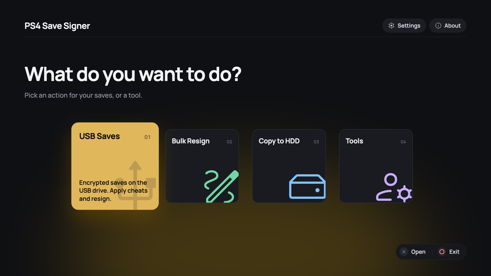
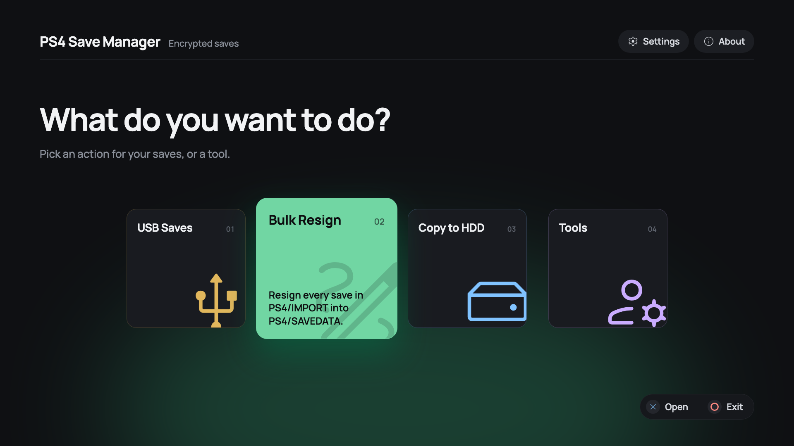

# PS4 Save Signer

PlayStation 4 homebrew app for encrypted save games on a USB drive. It resigns whole save packs for your account, copies them to the console, and applies cheats to them. Based on [Apollo Save Tool](https://github.com/bucanero/apollo-ps4).



*Renders of the menu design, not photos from a console.*

## Features

| Tile | What it does |
|------|--------------|
| **USB Saves** | Lists the encrypted saves on the USB drive. Select one to pick cheats and apply them; the save is resigned for you. |
| **Bulk Resign** | Resigns every save in `PS4/IMPORT/` and writes it to `PS4/SAVEDATA/<account-id>/`, keeping the sub-folders. |
| **Copy to HDD** | Copies every save in `PS4/SAVEDATA/<account-id>/<TITLE_ID>/` to the console, resigned for the current user. |
| **Tools** | Gives an Account ID to a PS4 user that never signed in to PSN. |

**Settings** and **About** are the two buttons at the top right (press <kbd>UP</kbd>).

Copies always work on every save found. To copy one save, leave only that one in the source folder.

## Install

Download the `.pkg` from the [latest release][app_latest], or from a build in the [Actions](../../actions) tab, and install it on a jailbroken PS4. It uses its own Title ID (`PSSS00001`) and data folder (`/data/ps4-save-signer/`), so it can sit next to other save tools.

## Bulk resign

An encrypted PS4 save is two files: the save image and its 96-byte `.bin` key, inside a folder named after the game's Title ID.



1. Copy your save pack to `PS4/IMPORT/<GAME NAME>/` on the USB drive. Any folder depth works, and `.zip` files holding a Title ID folder (`CUSA09171/<save>` + `.bin`) are unpacked for you.
2. Select **Bulk Resign** and confirm.
3. The resigned copies appear in `PS4/SAVEDATA/<account-id>/`, with the same sub-folders:

```
PS4/IMPORT/<GAME NAME>/#3. Hats Off!/CUSA09171/SAVESERVICE-LINE-0-3Slot(.bin)
        ↓
PS4/SAVEDATA/<account-id>/<GAME NAME>/#3. Hats Off!/CUSA09171/SAVESERVICE-LINE-0-3Slot(.bin)
```

Files in `PS4/IMPORT/` are not modified. A save whose resigned copy is already at the destination is skipped (delete the copy to resign it again), and the summary names the saves that failed. The current user needs an Account ID: use **Tools** if the account is not activated.

> [!IMPORTANT]
> The PS4, and **Copy to HDD**, only read saves from `PS4/SAVEDATA/<account-id>/<TITLE_ID>/`. To use a save, move its Title ID folder (e.g. `CUSA09171`) directly under `PS4/SAVEDATA/<account-id>/`.

## Cheats

Cheats come from one save patch file per game, `/data/ps4-save-signer/data/<TITLE_ID>.savepatch` (Save Wizard / Bruteforce Save Data format). The pkg bundles the [Apollo patch pack](https://github.com/bucanero/apollo-patches) and unpacks it on the first run of each version. A file with the same name placed there by hand replaces the bundled one.

1. Put the save in `PS4/SAVEDATA/<account-id>/<TITLE_ID>/` on the USB drive.
2. Open **USB Saves** and select the save.
3. Select the cheats. The ones the game always needs (decrypt, checksum) are selected for you.
4. Select **Apply Changes & Resign**. The save on the USB drive is changed in place: keep a copy of the original.

## Building

Needs the [Open Orbis SDK](https://github.com/OpenOrbis/OpenOrbis-PS4-Toolchain/) and these libraries installed in it: [apollo-lib](https://github.com/bucanero/apollo-lib), [mbedTLS 2.16.12](https://github.com/Mbed-TLS/mbedtls/releases/tag/v2.16.12), [cURL](https://github.com/bucanero/oosdk_libraries/tree/master/curl-7.64.1), [libZip](https://github.com/bucanero/oosdk_libraries/tree/master/libzip-1.9.2), [SDL2](https://github.com/PacBrew/SDL/tree/ps4), [libJbc](https://github.com/bucanero/ps4-libjbc), [libSQLite](https://github.com/bucanero/libSQLite-ps4), [mini18n](https://github.com/bucanero/mini18n), [dbglogger](https://github.com/bucanero/dbglogger). `.github/workflows/build.yml` shows how to build all of them.

```sh
make createzip   # optional: bundle the latest save patches (cheats)
make             # build the .pkg
```

With `PS3LOAD=tcp:<ps4-ip>` set, a [ps3load client](https://github.com/bucanero/ps4load/tree/main/client) can send `eboot.bin` to the [PS4Load listener](https://github.com/bucanero/ps4load). `make DEBUGLOG=1` sends debug messages to UDP multicast `239.255.0.100:30000`; receive them with [socat][]:

```sh
socat udp4-recv:30000,ip-add-membership=239.255.0.100:0.0.0.0 -
```

## Credits

Based on [Apollo Save Tool](https://github.com/bucanero/apollo-ps4) by [Bucanero](https://github.com/bucanero). Thanks to [Dnawrkshp](https://github.com/Dnawrkshp/) ([Artemis PS3](https://github.com/Dnawrkshp/ArtemisPS3)), [hzh](https://github.com/hzhreal)/[Team-Alua](https://github.com/Team-Alua/cecie.nim) ([vsh-utils](https://github.com/hzhreal/PS4-vsh-utils)), [flatz](https://github.com/flatz) ([SFO tools](https://github.com/bucanero/pfd_sfo_tools/)), [aldostools](https://aldostools.org/) ([Bruteforce Save Data](https://bruteforcesavedata.forumms.net/)), the [Manrope](https://github.com/sharanda/manrope) font (OFL) and [Material Symbols](https://fonts.google.com/icons) (Apache 2.0).

## License

Copyright (C) 2020-2026 [Damian Parrino](https://twitter.com/dparrino) for the original Apollo Save Tool.

This program is free software: you can redistribute it and/or modify it under the terms of the [GNU General Public License][app_license] as published by the Free Software Foundation, either version 3 of the License, or (at your option) any later version.

[socat]: http://www.dest-unreach.org/socat/
[app_latest]: https://github.com/leo-recchiette/PS4-Save-Manager/releases/latest
[app_license]: LICENSE
